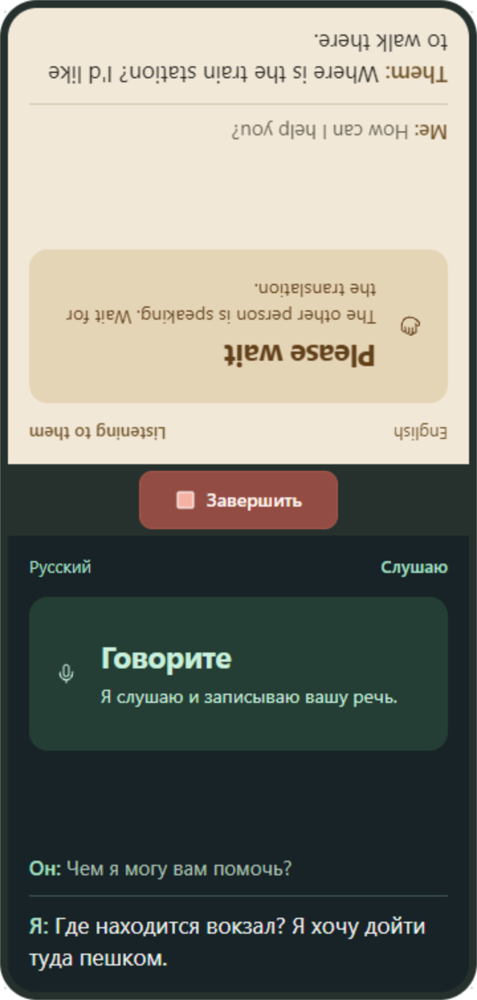
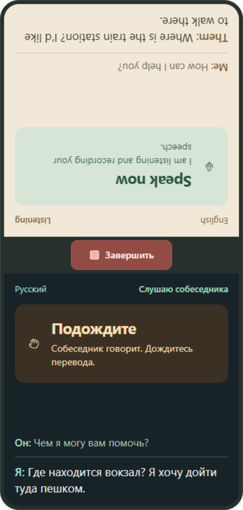
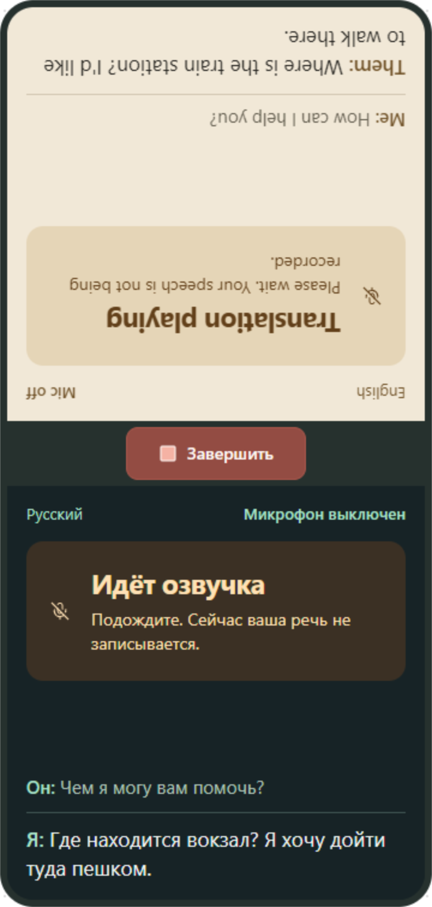
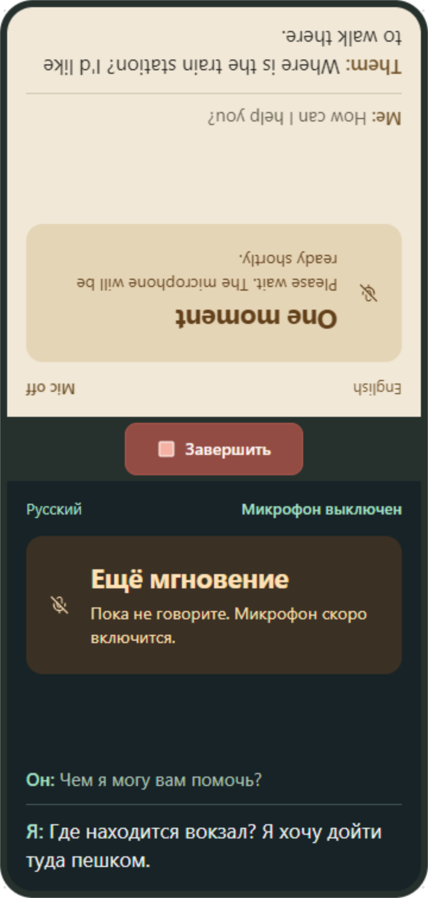
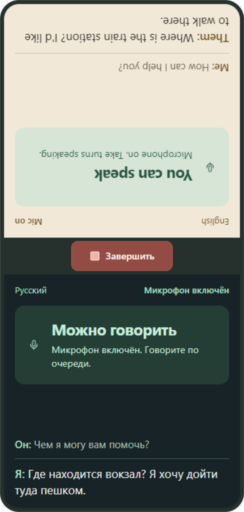
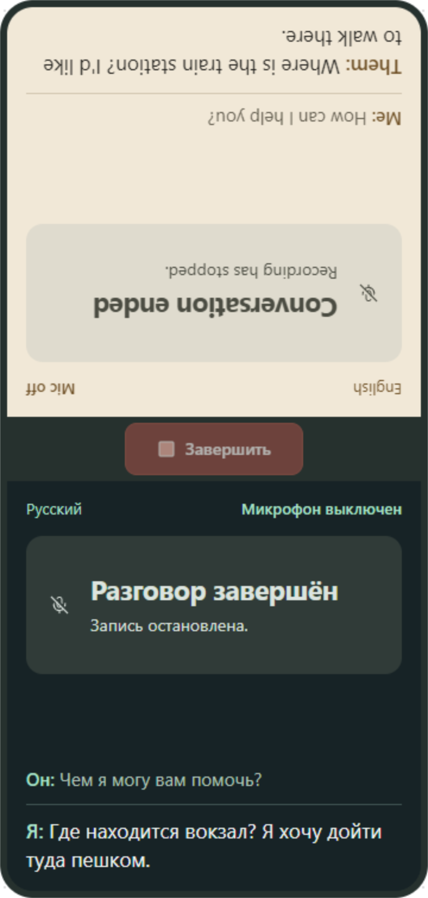
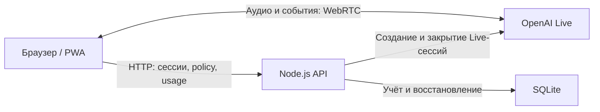

# Live Translator

Веб-приложение для устного разговора двух людей на разных языках через один телефон. Каждый участник видит текст на своём языке, а перевод озвучивается через динамик устройства. Приложение работает в браузере и может устанавливаться как PWA.

Проект находится на стадии MVP. В коде есть работа с микрофоном, потоковыми субтитрами, восстановлением сессий и учётом использования OpenAI; качество перевода и поведение аудио нужно проверять на физических устройствах.

## Дизайн и состояния приложения

Сохранённая серия макетов от **16 октября 2026 года** показывает разговор на русском и английском в шести состояниях. Нажмите на изображение, чтобы открыть его целиком.

| Говорит участник A | Говорит участник B | Идёт озвучка перевода |
|---|---|---|
| [](docs/images/app-states/01-source-a-speaking.png) | [](docs/images/app-states/02-source-b-speaking.png) | [](docs/images/app-states/03-translation-playing.png) |

| Пауза после озвучки | Микрофон готов | Разговор завершён |
|---|---|---|
| [](docs/images/app-states/04-post-playback-pause.png) | [](docs/images/app-states/05-microphone-ready.png) | [](docs/images/app-states/06-conversation-ended.png) |

Изображения перенесены без изменений из локальной серии `output/status-next-to-text-2026-10-16/` в [docs/images/app-states](docs/images/app-states), чтобы ссылки работали в репозитории. Это зафиксированный вариант дизайна; подписи, расположение статусов и кнопок могут отличаться от текущей сборки. Описание палитры, типографики и компонентов находится в [DESIGN.md](DESIGN.md); фактический интерфейс задают компоненты и CSS в `apps/web/src`.

## Как пользоваться

1. Выберите свой язык и язык собеседника. Язык владельца сначала берётся из настроек устройства; выбранная пара запоминается в браузере.
2. Нажмите «Начать перевод» и разрешите доступ к микрофону.
3. Положите телефон между участниками в портретной ориентации. Верхняя панель развёрнута к собеседнику, нижняя — к владельцу телефона.
4. Говорите по очереди, ориентируясь на подсказки в своей панели. Приложение задаёт модели последовательный перевод после завершения реплики.
5. Нажмите «Завершить», чтобы закрыть разговор. Его текст останется доступен для просмотра до возврата на начальный экран.

Во время озвучки перевода и короткой паузы после неё захват речи закрыт для защиты от эха. Речь в этот момент не записывается. Принадлежность реплик определяется по выбранным языкам; обязательного чередования A → B нет.

## Устройство проекта



Аудио передаётся между браузером и OpenAI напрямую. API создаёт Live-сессии, контролирует их жизненный цикл и хранит журнал использования, когда включён ledger. Ключ OpenAI остаётся на сервере.

| Часть | Технологии и назначение |
|---|---|
| `apps/web` | React 19, TypeScript, Vite 7; интерфейс, WebRTC, Web Audio/AudioWorklet, субтитры и PWA |
| `apps/api` | Node.js 24, Express 5, OpenAI SDK, Zod; сессии, ограничения, SQLite и отчёты |
| `infra` | Docker Compose, образы API и веб-приложения, Caddy и пример конфигурации Nginx |
| `docs` | Спецификации, решения, планы, инструкции проверки и результаты экспериментов |

Основные модули клиента: `session/` управляет состоянием разговора, `live/` — соединением с моделью, `audio/` — захватом и воспроизведением, `conversation/` — репликами и текстом диалога. На сервере `accounting/` содержит журнал и фоновую очистку сессий, `persistence/` — SQLite и миграции, `reports/` — расчёт метрик.

## Локальный запуск

Нужны **Node.js 24**, **pnpm 10.34.1**, браузер с микрофоном, WebRTC и Web Audio, а также ключ OpenAI с доступом к используемой в коде модели `gpt-live-1`. Для перевода нужен интернет; PWA-кеш не делает перевод автономным.

Команды ниже приведены для PowerShell. Если не указано иное, выполняйте их из корня репозитория.

### 1. Зависимости и окружение

```powershell
pnpm install --frozen-lockfile
if (!(Test-Path -LiteralPath .env)) { Copy-Item -LiteralPath .env.example -Destination .env }
```

Отредактируйте корневой `.env`. Файл `.env.example` рассчитан на развёртывание и внутренний тестовый профиль: для локального запуска замените origin и путь к базе.

```dotenv
OPENAI_API_KEY=...
WEB_ORIGIN=http://localhost:5173
USAGE_LEDGER_ENABLED=true
BACKGROUND_SESSION_CLOSE_ENABLED=false
USAGE_DB_PATH=../../.data/live-translator.sqlite
```

Этот относительный путь к SQLite рассчитан на запуск API из `apps/api`, как показано ниже. База и её каталог создаются автоматически. Можно использовать абсолютный путь. Если `.env` уже настроен, сохраните существующие ключ, базу и выбранные флаги.

### 2. Сборка интерфейса

```powershell
pnpm --filter @live-translator/web build
```

### 3. API и веб-сервер

В первом терминале, начиная из корня:

```powershell
Set-Location apps/api
node --env-file-if-exists=../../.env ./node_modules/tsx/dist/cli.mjs watch src/server.ts
```

Во втором терминале, также начиная из корня:

```powershell
Set-Location apps/web
node node_modules/vite/bin/vite.js preview --host 127.0.0.1 --port 5173 --strictPort
```

Откройте [http://localhost:5173](http://localhost:5173). API слушает порт **3001**, запросы `/api` идут через прокси Vite. В preview явно используется **5173**, чтобы адрес браузера совпадал с `WEB_ORIGIN`.

Проверка доступности без создания платной Live-сессии:

```powershell
Invoke-RestMethod http://127.0.0.1:3001/health
Invoke-RestMethod http://localhost:5173/api/policy
```

Первый запрос должен вернуть `status: ok`, второй — текущую policy учёта и восстановления. Эти проверки подтверждают доступность API; микрофон, подключение к OpenAI и перевод проверяются отдельно.

Если pnpm не находит установленные CLI, сборку можно выполнить из `apps/web` напрямую:

```powershell
node ../../node_modules/typescript/bin/tsc --noEmit -p tsconfig.build.json
node node_modules/vite/bin/vite.js build
```

### Режим разработки

```powershell
pnpm dev
```

Эта команда запускает API и Vite dev server. **В dev-режиме намеренно показывается `DevSpikeScreen`**: экран `Connect`, диагностика микрофона и соединения. Обычный интерфейс переводчика открывается через сборку и `vite preview`. После изменения исходников preview требует новой сборки.

## Android через USB

Включите отладку по USB, подключите телефон и разрешите доступ компьютеру. Нужен установленный `adb` из Android SDK Platform Tools. API и preview должны быть запущены по инструкции выше.

```powershell
adb devices -l
$deviceSerial = "SERIAL_FROM_ADB_DEVICES"
adb -s $deviceSerial reverse tcp:5173 tcp:5173
adb -s $deviceSerial reverse --list
adb -s $deviceSerial shell am start -a android.intent.action.VIEW -d http://localhost:5173 -p com.android.chrome
```

Замените `SERIAL_FROM_ADB_DEVICES` на серийный номер подключённого устройства. USB reverse направляет `localhost:5173` телефона на компьютер. Сохраняйте USB-подключение: такой адрес даёт защищённый контекст для микрофона без публичного туннеля. Для удалённого доступа нужен HTTPS.

Если телефон показывает старую версию после пересборки, проверьте service worker и Cache Storage именно у локального origin. Удалите его service worker и кеши, затем выполните перезагрузку с обходом HTTP-кеша. Сохраните IndexedDB, localStorage и cookies: они нужны для восстановления, доставки usage и языковых настроек. Подробная процедура и проверки реального телефона описаны в [AGENTS.md](AGENTS.md).

## Конфигурация

Полный пример — [.env.example](.env.example), проверка значений и значения по умолчанию — [apps/api/src/config.ts](apps/api/src/config.ts). Переменные API читаются при запуске процесса.

| Переменная | Значение по умолчанию, если не задана | Назначение |
|---|---|---|
| `OPENAI_API_KEY` | — | Серверный ключ OpenAI; не передавайте его через `VITE_*` |
| `WEB_ORIGIN` | `http://localhost:5173` в development | Точный origin без пути и завершающего `/`; в production обязателен HTTPS |
| `USAGE_LEDGER_ENABLED` | `false` | Постоянный журнал разговоров, Live-попыток и usage |
| `BACKGROUND_SESSION_CLOSE_ENABLED` | `false` | Закрытие Live-сессии при уходе в фон и восстановление разговора; требует включённого ledger |
| `USAGE_DB_PATH` | `/data/live-translator.sqlite` | Путь SQLite; для запуска вне Docker задайте доступный локальный путь |
| `MAX_CONCURRENT_SESSIONS` | `5` | Ограничение одновременных локальных резервирований |
| `LIVE_SESSION_RATE_LIMIT` | `20` | Число попыток создания за окно на IPv4-адрес или IPv6-префикс `/56` |
| `LIVE_SESSION_RATE_WINDOW_MS` | `600000` | Окно ограничения попыток, миллисекунды |
| `LIVE_SESSION_LEASE_MS` | `900000` | Срок локального резервирования; сам по себе не закрывает сессию OpenAI |
| `CONVERSATION_RETENTION_MS` | `300000` | Окно восстановления приостановленного разговора |
| `MAX_PROVIDER_SESSION_MS` / `MAX_CONVERSATION_ELAPSED_MS` | `900000` / `900000` | Серверные пределы длительности |

В `.env.example` явно заданы повышенные лимиты внутреннего тестирования: 15 одновременных сессий и 60 попыток создания за 10 минут. Это отличается от значений по умолчанию в коде. `API_BIND_PORT` и `WEB_BIND_PORT` настраивают порты Docker на хосте; порт Node API при локальном запуске остаётся 3001.

Флаги принимают `true` или `false`, числовые настройки — положительные целые в допустимых диапазонах. Некорректная конфигурация останавливает запуск. Параметры клиентских таймеров находятся в [apps/web/src/config/runtime.ts](apps/web/src/config/runtime.ts): в том числе предел разговора 15 минут и непрерывной исходной реплики 30 секунд.

## Состояние и хранение данных

- Серверный SQLite-журнал хранит идентификаторы, состояния, длительности, usage и технические метрики. Аудио и тексты реплик в этот журнал не записываются.
- Текст диалога хранится в памяти открытой страницы, включая просмотр после завершения разговора. Это не постоянный архив: перезагрузка страницы не восстанавливает полную историю реплик.
- Браузер использует localStorage для языковых предпочтений, IndexedDB и sessionStorage для восстановления и очередей доставки метаданных. Снимок восстановления может содержать текст контекста разговора, но не полную расшифровку и не аудио.
- При включённом фоновом закрытии продолжение разговора создаёт новую Live-сессию в рамках того же логического разговора. Незавершённую реплику может потребоваться повторить. Поворот в landscape приостанавливает перевод.
- SQLite рассчитан на один процесс API и локальный диск. В Docker база находится в постоянном томе `usage-data`. Сохраняйте базу и незавершённые записи очистки при обновлениях; выключение ledger при существующей базе приостанавливает создание новых сессий, сохраняя пути завершения и восстановления.

Доступ к микрофону требует защищённого контекста (`localhost` или HTTPS). Анонимная cookie привязывает метаданные к браузеру; проверка Origin и лимиты запросов не заменяют аутентификацию при публичном развёртывании.

## Проверки

Основные команды из корня:

```powershell
pnpm typecheck
pnpm lint
pnpm test
pnpm build
```

`pnpm test` запускает unit- и integration-тесты клиента и API. Обычные браузерные E2E используют имитацию Live API и не создают платные сессии:

```powershell
pnpm --filter @live-translator/web exec playwright install chromium webkit
pnpm --filter @live-translator/web exec playwright test --config=playwright.config.ts
pnpm --filter @live-translator/web test:audio
```

E2E-конфигурация собирает веб-приложение и использует preview на порту 4173. `test:audio` отдельно проверяет браузерное аудио и WebRTC в локальном harness на порту 5184 без OpenAI.

```powershell
pnpm test:real-two-way
```

Последняя команда запускает тесты с **реальным OpenAI и платными Live-сессиями**. Она требует рабочего ключа и доступа к модели; запускайте её отдельно от обычных проверок. Перед запуском освободите порты 3001 и 4173, используйте отдельную тестовую базу и проверьте условия в [playwright.real.config.ts](apps/web/playwright.real.config.ts) и [самом тесте](apps/web/tests/real/two-way-desktop.spec.ts).

[CI](.github/workflows/ci.yml) выполняет lint, typecheck, unit/integration-тесты, сборку, API smoke, Chromium/WebKit E2E, аудиорегрессии и проверки Docker с сохранением SQLite. Результаты таких проверок не заменяют проверку речи, эха и восстановления на телефоне.

## Отчёты и развёртывание

После сборки API доступны CLI для отчёта по unit economics и обслуживания SQLite:

```powershell
pnpm --filter @live-translator/api build
node apps/api/scripts/sqlite-maintenance.mjs verify --db .data/live-translator.sqlite
node apps/api/scripts/unit-economics-report.mjs --db .data/live-translator.sqlite --dataset product --from 2026-10-01T00:00:00Z --to 2026-11-01T00:00:00Z
```

Пути в этих командах рассчитаны на локальную базу из инструкции запуска. Отчёт открывает существующую базу только для чтения; начало периода включительно, конец — исключительно. Для продуктовых, экспериментальных и синтетических данных используйте отдельные базы и соответствующий `--dataset`. Подтверждённая ценовая policy в коде не задана: денежная оценка может быть недоступна и не является счётом OpenAI. Backup и restore описаны в инструкции эксплуатации.

Развёртывание подготовлено для Docker Compose: Caddy раздаёт собранную PWA, Express работает в отдельном контейнере, внешний Nginx обслуживает HTTPS и направляет `/api` в API. Порты контейнеров публикуются только на loopback. Порядок настройки окружения, запуска, резервного копирования и отката: [docs/VPS_DEPLOY.md](docs/VPS_DEPLOY.md).

## Документация

- [Индекс документов](docs/README.md) — назначение спецификаций, планов, решений и экспериментов.
- [Спецификация MVP](docs/superpowers/specs/2026-09-13-live-translator-mvp-design.md).
- [Учёт использования и жизненный цикл](docs/specs/2026-09-21-unit-economics-and-session-lifecycle.md).
- [Архитектурные решения](docs/architecture/decisions/README.md).
- [Проверки на устройстве](docs/testing/device-acceptance-checklist.md) и [маршрутизация по языкам](docs/testing/language-routing.md).
- [Проверки unit economics и их ограничения](docs/testing/unit-economics-acceptance.md).

У планов и экспериментальных документов есть собственные статусы и даты. Наличие документа не означает, что описанная функция включена или проверена на production.
